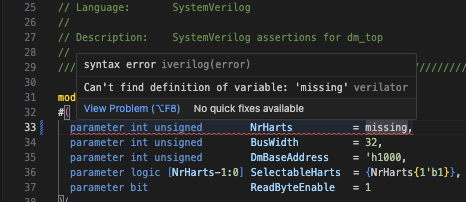
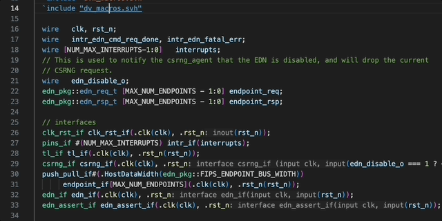
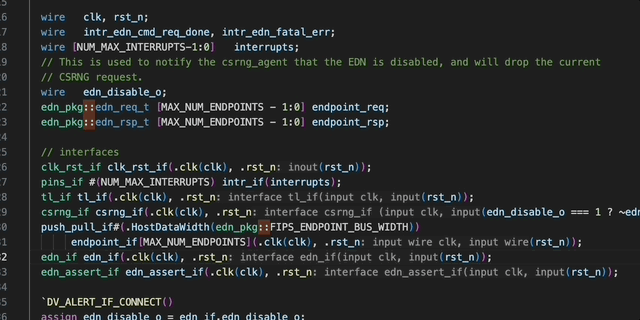
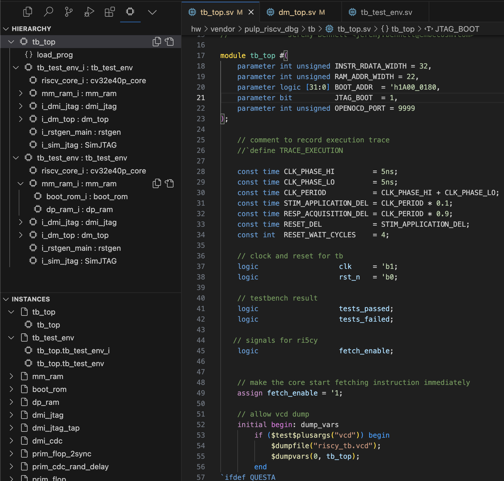

# slang-server: a SystemVerilog Language Server

Verilog and SystemVerilog support including linting from popular tools, completions, formatting, and project level analysis.

Install it from the [VS Code Marketplace](https://marketplace.visualstudio.com/items/AndrewNolte.vscode-system-verilog) or [OpenVSX](https://open-vsx.org/extension/AndrewNolte/vscode-system-verilog)

<!--
[](https://marketplace.visualstudio.com/items?itemName=AndrewNolte.vscode-system-verilog)
[](https://marketplace.visualstudio.com/items?itemName=AndrewNolte.vscode-system-verilog) -->

## 3rd Party Linters

### [`iverilog`](https://github.com/steveicarus/iverilog) (Icarus) || [`verilator`](https://github.com/verilator/verilator) || [`modelsim`](https://eda.sw.siemens.com/en-US/ic/modelsim/) || [`xvlog`](https://www.xilinx.com/products/design-tools/vivado.html) (Xilinx/Vivado) || [`xrun`](https://www.cadence.com/en_US/home/tools/system-design-and-verification/simulation-and-testbench-verification/xcelium-simulator.html) (Cadence/Xcelium)

The extension currently leverages the "-y" flag found on most tools, pointing it to a symlink index of the repo. This makes for almost zero per-project config when modules match each file name. A command titled `Verilog: Fix filenames...` is offered to help with refactoring these to match.

Note for windows users: "Developer Mode" needs to be turned on in order to create symlinks.

Multiple linters are able to run in parallel:



## Language Server

Snappy Hover/Goto Definition on nearly every symbol, including in other files. Optional inlay hints for ports.



Completions- Modules, Params/Ports, Macros, Package references, SV builtins, etc.



Set top level or build.f file, which shows the hierarchy, different modules used, project level linting, and soon to be waveform integration.

<!-- {: width="50%" height="auto"}
 -->
 

### See a detailed feature list and roadmap in [FEATURES.md](FEATURES.md)

## Formatters

### [`verible-verilog-format`](https://github.com/chipsalliance/verible/tree/master/verilog/formatting) (recommended) || [`verilog-format`](https://github.com/ericsonj/verilog-format) || [`istyle`](https://github.com/thomasrussellmurphy/istyle-verilog-formatter)

Verible supports both SystemVerilog and Verilog, while the others are only slang. `slang.formatDirs` lets you specify directories that you want to be formatted.
In the future slang will have its own formatter.

<br>

### Example Configuration

Generic langauge server setup in `.slang-server.json`

```json
// these get passed to linters and other tools with -I, or the correct format for that tool
{
  "includes": ["hdl/lib", "hdl/includes"],
  "flags": "-Wno-sign-conversion"
}
```

Vscode-specific configuration for 3rd party tools in `.vscode/settings.json`

```json
// includes and '-y .sv_cache/files' are already passed to linters
"slang.path": "/usr/local/bin/slang-server",
// multiple linters can run concurrently
// tools will use the default name on the path if not given
"slang.lint.verilator.path": "/usr/local/bin/verilator"
// you can specify if some can only run at the project level (top level or build.f set)
"slang.lint.verilator.projectEnabled": true,
"slang.svFormat.formatter": "verible-verilog-format",
"slang.svFormat.verible.args": "--flagfile=myflags.txt",
"slang.svFormat.verible.path": "/usr/local/bin/verible-verilog-format",
// select directories to format on save
"slang.formatDirs": [
    "hdl/my/project/with/formatting"
],
```

### See all config options in [CONFIG.md](CONFIG.md)

For debugging your config, you can see the logs in Output tab > select 'Slang' in the dropdown

### Contributions are welcome, see [DEVELOPING.md](DEVELOPING.md)
